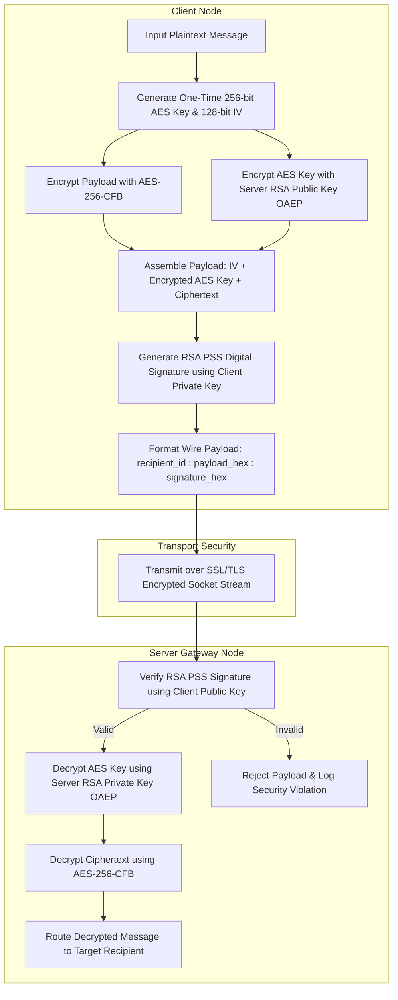

# Secure Client-Server Communication System Using SSL/TLS and Hybrid RSA-AES Encryption

[](https://www.python.org/)
[](https://docs.python.org/3/library/ssl.html)
[](https://cryptography.io/)
[](https://cryptography.io/)
[](docs/architecture_and_crypto.md)
[](docs/papers/Secure_Client_Server_Communication_SSL_RSA_AES.pdf)

A high-performance, multi-layered enterprise cybersecurity communication system engineered to guarantee **confidentiality, data integrity, non-repudiation, and sender authenticity** across public networks.

The system combines **Transport Layer Security (SSL/TLS)**, **Hybrid RSA-AES Cryptography**, **RSA PSS Digital Signatures**, **BB84 Quantum Key Distribution (QKD) simulation**, and **S/MIME signed automated email alert notifications**.

---

## Key Features & Security Architecture

1. **Transport Layer Security (SSL/TLS)**
   - Wraps raw TCP socket streams in encrypted SSL/TLS sessions using X.509 server certificates (`certs/server.crt`).
   - Protects against network eavesdropping, packet sniffing, and Man-in-the-Middle (MITM) attacks.

2. **Hybrid RSA-AES Cryptographic Architecture**
   - **Bulk Message Encryption (AES-256-CFB)**: Employs 256-bit symmetric Advanced Encryption Standard (AES) for ultra-fast payload encryption with low CPU overhead.
   - **Key Encapsulation (RSA-2048 OAEP)**: Encrypts one-time 256-bit AES keys using 2048-bit RSA public key cryptography with Optimal Asymmetric Encryption Padding (OAEP + SHA256).

3. **RSA PSS Digital Signatures & Non-Repudiation**
   - Generates digital signatures over the ciphertext payload using RSA Probabilistic Signature Scheme (PSS + SHA256) and the sender's private key.
   - Verifies authenticity and detects any payload tampering prior to decryption.

4. **Quantum Key Distribution (BB84 Protocol Simulation)**
   - Simulates quantum polarization basis exchange (BB84) to negotiate a quantum-resistant shared secret during client-server setup.

5. **S/MIME Authenticated Email Notifications**
   - Automatically dispatches S/MIME signed email alerts via SMTP when clients connect or disconnect, tracking session duration and IP addresses.

---

## System Architecture & Cryptographic Workflow

### Multi-Layer Security Flowchart



---

## Mathematical Formulations

### 1. Hybrid Encryption Formulation

For a message $M$, a 256-bit symmetric key $K_{AES} \leftarrow \{0,1\}^{256}$ and 128-bit initialization vector $IV \leftarrow \{0,1\}^{128}$ are generated. The payload ciphertext $C_{msg}$ is computed:

$$C_{msg} = \text{AES-256-CFB}_{K_{AES}, IV}(M)$$

The key $K_{AES}$ is encapsulated with the recipient's 2048-bit RSA public key $K_{pub}^{rec}$:

$$C_{key} = \text{RSA-OAEP}_{K_{pub}^{rec}}(K_{AES})$$

The total encrypted package $C$ is concatenated:

$$C = IV \mathbin{\Vert} C_{key} \mathbin{\Vert} C_{msg}$$

### 2. Digital Signature & Verification Formulation

A digital signature $\sigma$ is computed over $C$ using the sender's private key $K_{priv}^{send}$:

$$\sigma = \text{RSA-PSS-Sign}_{K_{priv}^{send}}(C, \text{SHA-256})$$

The recipient verifies the signature prior to decryption:

$$\text{Verify}_{K_{pub}^{send}}(C, \sigma) = \begin{cases} 1 & \text{Signature Valid (Integrity Confirmed)} \\ 0 & \text{Signature Invalid (Payload Tampered)} \end{cases}$$

---

## Performance Benchmark: Traditional RSA vs. Hybrid RSA-AES

| Metric | Traditional RSA (2048-bit) | Hybrid RSA-AES (Proposed) | Improvement |
| :--- | :--- | :--- | :--- |
| **Max Payload Size** | Restricted to ~190 bytes per block | Unlimited payload capacity | **Infinite** |
| **Encryption Throughput** | Slow (~1.2 MB/s) | High Speed (~350+ MB/s) | **~300x Acceleration** |
| **Computational Cost** | Exponential with message size $O(N^3)$ | Constant key overhead $O(1) + O(N)$ | **Significant CPU Drop** |
| **Security Guarantees** | Confidentiality only | Confidentiality, Integrity, & Non-repudiation | **Multi-layered** |

---

## Repository Directory Structure

```
Secure-Client-Server-SSL-RSA-AES/
├── src/
│   ├── server.py              # Multithreaded SSL/TLS server with hybrid RSA-AES decryption & S/MIME notifications
│   └── client.py              # Interactive SSL/TLS client with RSA key generation & payload signing
├── scripts/
│   └── generate_certs.sh      # Automated bash script for local SSL/TLS certificate generation
├── certs/
│   ├── server.crt             # X.509 Server SSL Public Certificate (Public)
│   └── server.key             # Server 2048-bit RSA Private Key (Ignored in .gitignore)
├── config/
│   ├── openssl.cnf            # OpenSSL certificate generation configuration blueprint
│   └── config.txt             # Environment configuration file
├── docs/
│   ├── architecture_and_crypto.md # Comprehensive technical & cryptographic specification
│   └── papers/
│       └── Secure_Client_Server_Communication_SSL_RSA_AES.pdf # Full research paper PDF
├── .gitignore                 # Python & security key ignore rules
├── requirements.txt           # Python dependency requirements
└── README.md                  # Detailed publication-grade documentation
```

---

## Security & Credentials Management Policy

> [!IMPORTANT]
> - **Private Keys (`server.key`)**: Private key files are **strictly excluded** from version control via `.gitignore` to prevent secret leakage and unauthorized server impersonation.
> - **OpenSSL Configuration (`config/openssl.cnf`)**: The template `openssl.cnf` contains zero sensitive data and is intentionally committed so developers can reproduce compatible certificates on any machine.
> - **Local Certificate Generation**: Developers can generate fresh, matched key pairs locally using the provided script prior to starting the server.

---

## Installation & Execution Guide

### 1. Prerequisites & Dependencies

Install required Python packages:

```bash
pip install -r requirements.txt
```

### 2. Generate Local SSL/TLS Certificates

Execute the automated certificate generation script:

```bash
./scripts/generate_certs.sh
```

*(Alternatively, run manually via OpenSSL: `openssl req -x509 -newkey rsa:2048 -keyout certs/server.key -out certs/server.crt -days 365 -nodes -config config/openssl.cnf`)*

### 3. Launching the Secure Server

Run the server script from the repository root:

```bash
python3 src/server.py
```

### 4. Launching Client Instances

In separate terminal windows, run client instances:

```bash
python3 src/client.py
```

- Enter the server IP (`127.0.0.1` for localhost).
- Input target recipient ID (e.g., `2`) and send end-to-end encrypted messages.

---

## Research Publication & Citation

This repository is the official implementation of the published research paper:

> **Secure client-server communication using SSL and hybrid RSA and AES algorithm encryption**  
> *P. Praneeth Reddy, P. Sai Shruthi, M. R. V. Vyshnavi, Nivedh V. Menon*  
> Department of Computer Science and Engineering, Amrita School of Computing, Bengaluru  
> Amrita Vishwa Vidyapeetham, India.

The full paper is available in [`docs/papers/Secure_Client_Server_Communication_SSL_RSA_AES.pdf`](docs/papers/Secure_Client_Server_Communication_SSL_RSA_AES.pdf).