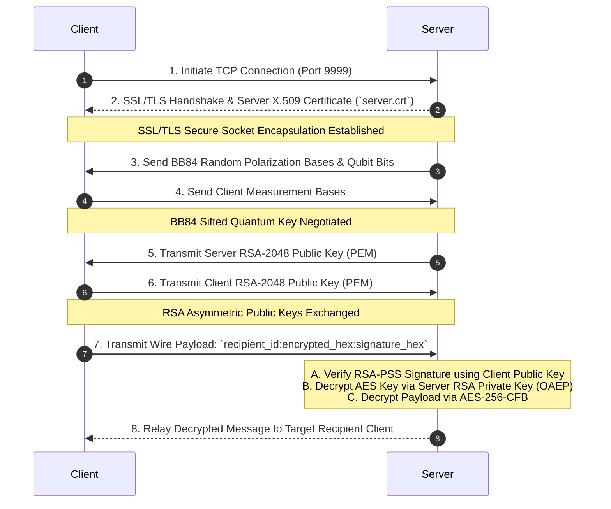

# Unified Secure Client-Server Communication System (SSL/TLS + BB84 QKD + Hybrid RSA-AES)

[](https://www.python.org/)
[](https://www.openssl.org/)
[]()
[]()
[]()
[]()

A production-grade, multi-layered secure client-server communication suite that unifies quantum key distribution and hybrid classical cryptography. This repository serves as the official joint implementation of **two peer-reviewed research publications**:
1. **Secure client-server communication using SSL and hybrid RSA and AES algorithm encryption**
2. **Multi-Client Server based Quantum Key Distribution**

---

## Technical Architecture & Security Flow

```
+-----------------------------------------------------------------------------------+
|                           Layer 1: Application Data                               |
+-----------------------------------------------------------------------------------+
                                          |
                                          v
+-----------------------------------------------------------------------------------+
|               Layer 2: BB84 Quantum Key Distribution (QKD) Protocol               |
| - Quantum bit & polarization basis exchange (Rectilinear + / Diagonal x).        |
| - Sifted secret key negotiation for quantum-resistant session security.           |
+-----------------------------------------------------------------------------------+
                                          |
                                          v
+-----------------------------------------------------------------------------------+
|                  Layer 3: AES-256 Bulk Data Encryption (CFB Mode)                 |
| - Fast, low-latency symmetric payload encryption using 256-bit AES & 128-bit IV.  |
+-----------------------------------------------------------------------------------+
                                          |
                                          v
+-----------------------------------------------------------------------------------+
|         Layer 4: RSA-2048 Asymmetric Key Encapsulation (OAEP + SHA-256)           |
| - Encapsulates one-time 256-bit AES key using recipient's RSA public key.         |
+-----------------------------------------------------------------------------------+
                                          |
                                          v
+-----------------------------------------------------------------------------------+
|             Layer 5: RSA-2048 Digital Signature Generation (PSS + SHA-256)        |
| - Generates non-repudiable digital signature over payload for integrity & origin. |
+-----------------------------------------------------------------------------------+
                                          |
                                          v
+-----------------------------------------------------------------------------------+
|               Layer 6: SSL/TLS Secure Transport Session (X.509 Cert)             |
| - Encapsulates all TCP wire traffic in encrypted SSL/TLS session (Port 9999).     |
+-----------------------------------------------------------------------------------+
                                          |
                                          v
+-----------------------------------------------------------------------------------+
|               Layer 7: S/MIME Authenticated Email Server Alerts                   |
| - Dispatches PKCS1v15 + SHA256 signed email alerts on client connect/disconnect. |
+-----------------------------------------------------------------------------------+
```

---

## Cryptographic Protocol Sequence



---

## Repository Directory Structure

```
Secure-Client-Server-SSL-RSA-AES-QKD/
├── src/
│   ├── server.py              # Multithreaded SSL/TLS server with QKD, RSA-AES hybrid decryption & S/MIME alerts
│   └── client.py              # Interactive SSL/TLS client with QKD basis exchange & RSA payload signing
├── scripts/
│   └── generate_certs.sh      # Automated bash script for local SSL/TLS certificate generation
├── tests/
│   └── test_communication.py  # End-to-end automated cryptographic integration test suite
├── certs/
│   ├── server.crt             # X.509 Server SSL Public Certificate (Public)
│   └── server.key             # Server 2048-bit RSA Private Key (Ignored in .gitignore)
├── config/
│   ├── openssl.cnf            # OpenSSL certificate generation configuration blueprint
│   └── config.txt             # Environment configuration file
├── docs/
│   ├── architecture_and_crypto.md # Detailed mathematical & protocol reference guide
│   └── papers/
│       ├── Secure_Client_Server_Communication_SSL_RSA_AES.pdf # Paper #1 PDF
│       └── Multi_Client_Server_based_Quantum_Key_Distribution.pdf # Paper #2 PDF
├── .gitignore                 # Python cache & security key ignore rules
├── requirements.txt           # Python dependency specifications
└── README.md                  # Comprehensive project documentation
```

---

## Security & Credentials Management Policy

> [!IMPORTANT]
> - **Private Keys (`server.key`)**: Private key files are **strictly excluded** from version control via `.gitignore` to prevent secret leakage and unauthorized server impersonation.
> - **OpenSSL Configuration (`config/openssl.cnf`)**: The template `openssl.cnf` contains zero sensitive data and is intentionally committed so developers can reproduce compatible certificates on any machine.
> - **Local Certificate Generation**: Developers can generate fresh, matched key pairs locally using `./scripts/generate_certs.sh` prior to running the system.

---

## Quickstart & Verification Guide

### 1. Install Dependencies

```bash
pip install -r requirements.txt
```

### 2. Generate Local SSL/TLS Certificates

```bash
./scripts/generate_certs.sh
```

### 3. Run Automated Integration Test Suite

Run the end-to-end test suite to verify SSL connection wrapping, BB84 QKD basis exchange, RSA key pair generation, AES-256-CFB payload encryption, and RSA-PSS signature verification:

```bash
python3 tests/test_communication.py
```

### 4. Launching Server & Clients Manually

**Terminal 1 (Server)**:
```bash
python3 src/server.py
```

**Terminal 2 (Client 1)**:
```bash
python3 src/client.py
```

**Terminal 3 (Client 2)**:
```bash
python3 src/client.py
```

- Enter target recipient ID (e.g. `2`) to transmit end-to-end encrypted messages.

---

## Research Publications & Citations

This repository is the official unified implementation of the following research papers:

### Paper #1: Hybrid RSA-AES & Transport Security
> **Secure client-server communication using SSL and hybrid RSA and AES algorithm encryption**  
> *P. Praneeth Reddy, P. Sai Shruthi, M. R. V. Vyshnavi, Nivedh V. Menon*  
> Department of Computer Science and Engineering, Amrita School of Computing, Bengaluru  
> Amrita Vishwa Vidyapeetham, India.  
> [PDF Document](docs/papers/Secure_Client_Server_Communication_SSL_RSA_AES.pdf)

### Paper #2: Quantum Key Distribution Protocol
> **Multi-Client Server based Quantum Key Distribution**  
> *P. Praneeth Reddy, P. Sai Shruthi, P. Tharneesh, Nivedh V. Menon, Shinu M. R.*  
> Department of Computer Science and Engineering, Amrita School of Computing, Bengaluru  
> Amrita Vishwa Vidyapeetham, India.  
> [PDF Document](docs/papers/Multi_Client_Server_based_Quantum_Key_Distribution.pdf)