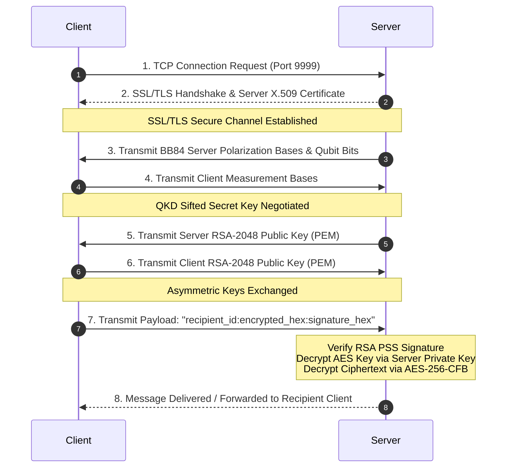

# Technical Cryptographic & Architecture Reference Guide

This document details the multi-layered security architecture, mathematical formulations, and protocol workflows for the **Unified Secure Client-Server Communication System (SSL/TLS + BB84 QKD + Hybrid RSA-AES Encryption)**.

---

## 1. Security Layer Breakdown

```
+-----------------------------------------------------------------------+
|                       Application Payload Data                        |
+-----------------------------------------------------------------------+
                                   |
                                   v
+-----------------------------------------------------------------------+
| Layer 1: BB84 Quantum Key Distribution (QKD) Key Negotiation          |
| - Simulates quantum polarization basis exchange (+ and x).            |
| - Establishes quantum-resistant sifted session key.                   |
+-----------------------------------------------------------------------+
                                   |
                                   v
+-----------------------------------------------------------------------+
| Layer 2: AES-256 Symmetric Data Encryption (CFB Mode)                 |
| - Fast, low-latency encryption of message payloads.                   |
+-----------------------------------------------------------------------+
                                   |
                                   v
+-----------------------------------------------------------------------+
| Layer 3: RSA-2048 Asymmetric Key Encapsulation (OAEP + SHA256)        |
| - Encrypts single-use AES-256 key using server public key.            |
+-----------------------------------------------------------------------+
                                   |
                                   v
+-----------------------------------------------------------------------+
| Layer 4: RSA PSS Digital Signature Generation (SHA256)                |
| - Sender signs payload to guarantee message integrity & authenticity. |
+-----------------------------------------------------------------------+
                                   |
                                   v
+-----------------------------------------------------------------------+
| Layer 5: SSL/TLS Transport Layer Protocol (X.509 Certificate)        |
| - Wraps raw TCP socket in TLS session to prevent MITM eavesdropping.   |
+-----------------------------------------------------------------------+
                                   |
                                   v
+-----------------------------------------------------------------------+
| Layer 6: S/MIME Authenticated Server Notifications                    |
| - Generates PKCS1v15 + SHA256 signed email alerts for audit events.   |
+-----------------------------------------------------------------------+
```

---

## 2. Cryptographic Algorithms & Primitives

| Cryptographic Primitive | Algorithm / Parameter | Standard / Padding | Purpose |
| :--- | :--- | :--- | :--- |
| **Transport Layer Security** | TLS 1.2 / TLS 1.3 | X.509 Certificate (`server.crt`) | Encrypts TCP socket stream |
| **Quantum Key Exchange** | BB84 Protocol | Rectilinear (+) / Diagonal (x) | Quantum-resistant session key |
| **Symmetric Encryption** | AES-256 | CFB Mode (128-bit IV) | Bulk message payload encryption |
| **Asymmetric Encapsulation** | RSA 2048-bit | OAEP (MGF1 + SHA256) | Encrypts one-time 256-bit AES key |
| **Digital Signatures** | RSA 2048-bit | PSS (MGF1 + SHA256, Salt=Max) | Message integrity & non-repudiation |
| **Notification Security** | S/MIME Email | PKCS1v15 + SHA256 Signature | Authenticated server alert emails |

---

## 3. Mathematical Formulations

### A. BB84 Quantum Key Distribution (QKD)
For a key length $N = 128$, the sender generates random bits $B_s \in \{0, 1\}^N$ and random bases $\theta_s \in \{+, \times\}^N$. The receiver selects random measurement bases $\theta_r \in \{+, \times\}^N$.

The sifted key $K_{QKD}$ is formed by filtering indices $i$ where bases match:

$$K_{QKD} = \{ B_{s,i} \mid \theta_{s,i} = \theta_{r,i} \}$$

### B. Hybrid Encryption Scheme
For plaintext message $M$, a fresh 256-bit AES key $K_{AES}$ and 128-bit initialization vector $IV$ are generated:

$$C_{msg} = \text{AES-256-CFB}_{K_{AES}, IV}(M)$$

Symmetric key $K_{AES}$ is encapsulated using recipient RSA public key $K_{pub}^{rec}$:

$$C_{key} = \text{RSA-OAEP}_{K_{pub}^{rec}}(K_{AES})$$

Full payload tuple $C$:

$$C = IV \mathbin{\Vert} C_{key} \mathbin{\Vert} C_{msg}$$

### C. Digital Signature Verification
Sender signs payload $C$ using RSA private key $K_{priv}^{send}$:

$$\sigma = \text{RSA-PSS-Sign}_{K_{priv}^{send}}(C, \text{SHA-256})$$

Recipient verifies signature using sender public key $K_{pub}^{send}$:

$$\text{Verify}_{K_{pub}^{send}}(C, \sigma) \stackrel{?}{=} \text{TRUE}$$

---

## 4. Communication Protocol Handshake Flow


