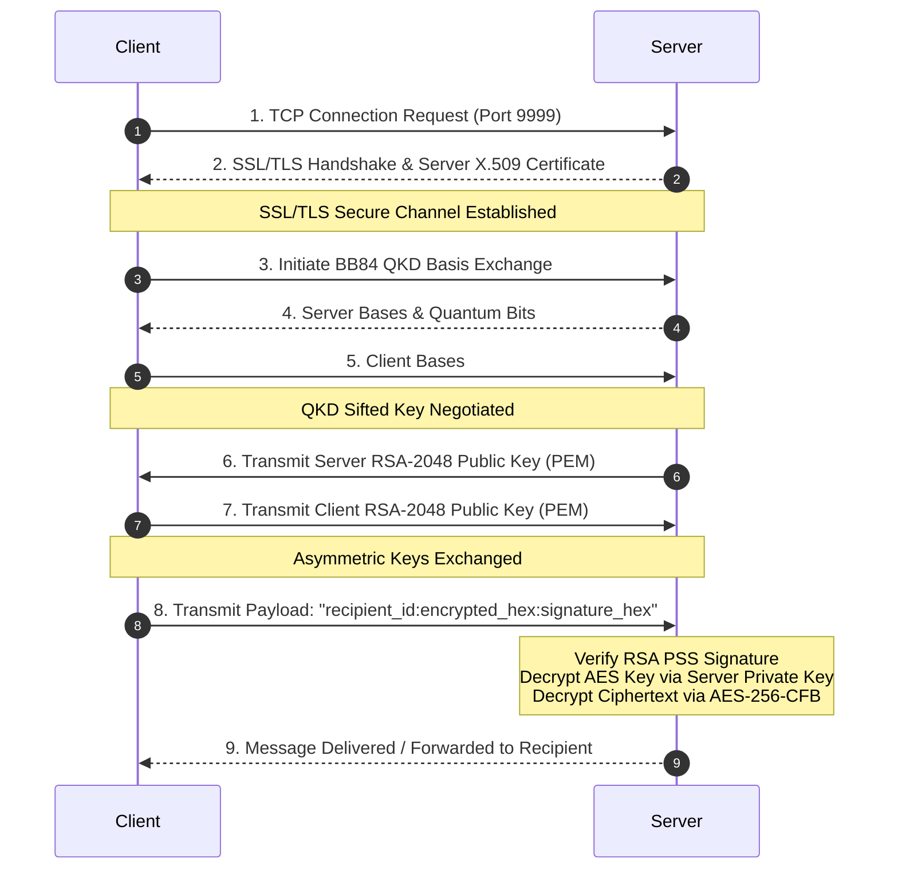

# Technical Cryptographic & Architecture Reference Guide

This document details the multi-layered security architecture, cryptographic primitives, and protocol workflows for the **Secure Client-Server Communication System Using SSL/TLS and Hybrid RSA-AES Encryption**.

---

## Security Layer Breakdown

```
+-----------------------------------------------------------------------+
|                       Application Payload Data                        |
+-----------------------------------------------------------------------+
                                   |
                                   v
+-----------------------------------------------------------------------+
| Layer 1: AES-256 Symmetric Data Encryption (CFB Mode)                 |
| - Fast, low-latency encryption of arbitrary message payloads.         |
+-----------------------------------------------------------------------+
                                   |
                                   v
+-----------------------------------------------------------------------+
| Layer 2: RSA-2048 Asymmetric Key Encapsulation (OAEP + SHA256)        |
| - Encrypts single-use AES-256 symmetric key using server public key.  |
+-----------------------------------------------------------------------+
                                   |
                                   v
+-----------------------------------------------------------------------+
| Layer 3: RSA PSS Digital Signature Generation (SHA256)                |
| - Sender signs payload to guarantee message integrity & authenticity. |
+-----------------------------------------------------------------------+
                                   |
                                   v
+-----------------------------------------------------------------------+
| Layer 4: SSL/TLS Transport Layer Protocol (X.509 Certificate)        |
| - Wraps raw TCP socket in TLS session to prevent MITM eavesdropping.   |
+-----------------------------------------------------------------------+
```

---

## 1. Cryptographic Algorithms & Primitives

| Cryptographic Primitive | Algorithm / Parameter | Standard / Padding | Purpose |
| :--- | :--- | :--- | :--- |
| **Transport Layer Security** | TLS 1.2 / TLS 1.3 | X.509 Certificate (`server.crt`) | Encrypts TCP socket stream |
| **Symmetric Encryption** | AES-256 | CFB Mode (128-bit IV) | Bulk message payload encryption |
| **Asymmetric Encapsulation** | RSA 2048-bit | OAEP (MGF1 + SHA256) | Encrypts one-time 256-bit AES key |
| **Digital Signatures** | RSA 2048-bit | PSS (MGF1 + SHA256, Salt=Max) | Message integrity & non-repudiation |
| **Quantum Key Exchange (Sim)**| BB84 Protocol | Sifted key matching basis | Quantum-resistant key negotiation |
| **Notification Security** | S/MIME Email | PKCS1v15 + SHA256 Signature | Authenticated server alert emails |

---

## 2. Mathematical Formulations

### A. Hybrid Encryption Scheme
For a plaintext message $M$, a fresh 256-bit AES key $K_{AES}$ and 128-bit initialization vector $IV$ are generated:

$$C_{msg} = \text{AES-256-CFB}_{K_{AES}, IV}(M)$$

The symmetric key $K_{AES}$ is encapsulated using the recipient's RSA public key $K_{pub}^{rec}$:

$$C_{key} = \text{RSA-OAEP}_{K_{pub}^{rec}}(K_{AES})$$

The complete encrypted ciphertext tuple $C$ is constructed:

$$C = IV \mathbin{\Vert} C_{key} \mathbin{\Vert} C_{msg}$$

### B. Digital Signature Verification
The sender generates a digital signature $\sigma$ over $C$ using their RSA private key $K_{priv}^{send}$:

$$\sigma = \text{RSA-PSS-Sign}_{K_{priv}^{send}}(C, \text{SHA-256})$$

The recipient verifies the signature using the sender's public key $K_{pub}^{send}$:

$$\text{Verify}_{K_{pub}^{send}}(C, \sigma) \stackrel{?}{=} \text{TRUE}$$

---

## 3. Communication Protocol Handshake Flow


